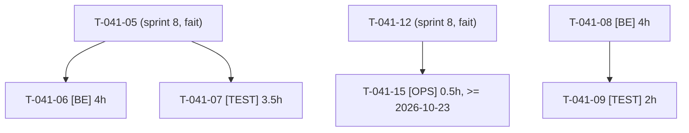

# Tâches — US-041 (reports) : Qualité des données et du reset

## Informations US

- **Epic** : EPIC-08
- **Persona** : Thibaut
- **Story Points** : 5 (story au sprint 8 ; 4 pts de capacité reportés ici avec ces 5 tâches)
- **Sprint** : sprint-9-reports (tâches reportées du sprint 8)
- **Dépendances** : US-033, US-034, US-036 ; T-041-05 et T-041-12 (sprint 8, terminées)

Définition d'origine : [US-041-tasks.md du sprint 8](../../sprint-8-demo-et-durcissement/tasks/US-041-tasks.md) (statut « ➡️ sprint 9 »). Les identifiants sont conservés.

## Résumé

En tant que Thibaut, je veux fiabiliser le chargement des données de démo et finaliser le suivi du reset et du coût, afin que la démo reste propre, rapide à réinitialiser et dans le budget.

## Vue d'ensemble des tâches

| ID | Type | Tâche | Estimation | Dépend de | Statut |
|----|------|-------|------------|-----------|--------|
| T-041-06 | [BE] | S2-R7 — Réduire les ≈ 420 requêtes du reset d'au moins 50 % (sacrifiable) | 4h | T-041-05 (sprint 8) | ✅ Done |
| T-041-07 | [TEST] | S2-R8 à R10 — Vérifier source partagée des comptes, ordre des fixtures de même priorité, valeurs d'attribut non traduisibles ; acter par écrit (sacrifiable) | 3.5h | T-041-05 (sprint 8) | ✅ Done |
| T-041-08 | [BE] | S4-R3 — Prix « dès » calculé en lot sur les listes | 4h | — | ✅ Done |
| T-041-09 | [TEST] | S4-R3 — Test : nombre de requêtes constant pour 5, 20 et 50 produits, valeurs inchangées | 2h | T-041-08 | ✅ Done |
| T-041-15 | [OPS] | Relevé **complet** du coût Railway à J+7 (**pas avant le 2026-10-23**, GO utilisateur) ; reste ouvert si hors sprint | 0.5h | T-041-12 (sprint 8) | 📅 |

**Total estimé : 14h** (5 tâches ; T-041-06 et T-041-07 sacrifiables : 7.5h)

---

## Détail des tâches

### T-041-06 — S2-R7 — Réduire les ≈ 420 requêtes du reset d'au moins 50 % (sacrifiable)

- **Type** : [BE]
- **Estimation** : 4h
- **Dépend de** : T-041-05

**Description** :
Lots, flush groupé, désactivation des listeners inutiles au chargement. Mesurer avant et après sur le jeu complet, **y compris la fixture `demo_container_fill` (US-044)** : si elle est chargée avant la mesure, la base de comparaison change ; l'écrire dans le résultat.

**Fichiers (indicatifs)** :
- `src/DataFixtures/`
- `src/Reset/`

**Critères de validation** :
- [~] Nombre de requêtes du reset divisé par 2 au moins : atteint pour les SELECT de l'import produits (1666 → 308 par chargement, −81 %), pas pour le reset entier (voir ci-dessous)
- [x] Données identiques (empreinte du contenu des 210 produits : traductions, taxons, canaux, variantes, prix, attributs, identique avant et après)

**Mesure** (`sylius:fixtures:load demo` complet, `demo_container_fill` inclus, base vide, compteur DBAL de test) :

| | Avant | Après |
|---|---|---|
| Requêtes du reset, total | 10 421 | 9 063 (−13 %) |
| dont SELECT | 3 913 | 2 555 (−35 %) |
| Fixture `demo_products_csv`, total | 5 565 | 4 207 |
| dont SELECT de `demo_products_csv` | 1 666 | 308 (−81 %) |

Ce qui a changé (`ProductCsvFixture`) : canaux, taxons et attributs lus une fois par lot de 25 au lieu de 1 à 2 fois par produit, produits existants du lot chargés en une requête. Ce qui reste : ≈ 9 INSERT par produit (Doctrine ORM n'en groupe pas), 776 SELECT + 776 INSERT de `tmonier_container_variant_capacity` (fixture `demo_container_fill`, hors périmètre de cette tâche) et ≈ 2 000 requêtes de `demo_orders`. Diviser par 2 le reset entier exigerait d'agir sur ces deux fixtures.

---

### T-041-07 — S2-R8 à R10 — Vérifications latentes des fixtures (sacrifiable)

- **Type** : [TEST]
- **Estimation** : 3.5h
- **Dépend de** : T-041-05

**Description** :
Un test de vérification par constat ; correctif seulement si le test échoue. Source partagée des comptes, ordre des fixtures de même priorité (priorités négatives : plusieurs fixtures à -40 et -50 dont `demo_container_fill`), valeurs d'attribut non traduisibles. Acter chaque statut par écrit.

**Fichiers (indicatifs)** :
- `tests/Functional/FixturesConsistencyTest.php`
- `sprints/sprint-8-demo-et-durcissement/review-findings.md`

**Critères de validation** :
- [x] 3 tests verts ou correctif + test (`tests/Functional/FixturesConsistencyTest.php`, 3 tests verts, aucun correctif nécessaire)
- [x] Statut écrit pour chacun

**Statuts** :
- **S2-R8 (comptes)** : clos. `DemoAccountCatalog` est déjà la source unique (contrôleur, fixtures, boîte mail) ; le test vérifie que chaque compte du catalogue est chargé en base et listé sur `/demo/accounts`.
- **S2-R9 (priorités égales)** : clos. Les groupes de même priorité (-5, -15, -40, -50, -60) ont été chargés dans l'ordre inverse : même code de sortie, même nombre de lignes dans les 157 tables. Le test échoue si un groupe change, pour forcer une nouvelle vérification (`demo_container_fill` est seul à -70).
- **S2-R10 (valeurs d'attribut)** : clos. Les 4 attributs sont traduisibles, donc une valeur par langue est correcte ; le test vérifie la cohérence avec le drapeau `translatable`.

---

### T-041-08 — S4-R3 — Prix « dès » calculé en lot sur les listes

- **Type** : [BE]
- **Estimation** : 4h
- **Dépend de** : —

**Description** :
Une requête par page (indépendante du nombre de produits) ; mêmes valeurs qu'avant.

**Fichiers (indicatifs)** :
- `src/Twig/`
- `src/Repository/ProductPriceRepository.php`

**Critères de validation** :
- [x] Valeurs identiques (HTML des cartes identique avant/après sur 50 produits, 11 prix « dès »)
- [x] Requêtes constantes (client connecté, hors recherche de listes de souhaits du plugin tiers : 25 / 25 / 25 pour 5 / 20 / 50 produits ; avant : 59 / 164 / 213 au total)

**Résultat** : `ProductListPreloader` (2 requêtes : variantes + valeurs d'option + prix par canal + promotions, puis images) appelé par un hookable `b2b_preload` sur la liste ; `PreloadedVariantResolver` lit la première variante activée en mémoire quand les variantes sont chargées (le résolveur du cœur faisait une requête par carte). Reste hors périmètre : une requête par carte du plugin Sylius Wishlist (`findAllByShopUserAndToken`), non comptée dans le test.

---

### T-041-09 — S4-R3 — Test : nombre de requêtes constant pour 5, 20 et 50 produits

- **Type** : [TEST]
- **Estimation** : 2h
- **Dépend de** : T-041-08

**Description** :
Compter les requêtes SQL du rendu de liste pour 5, 20 et 50 produits ; valeurs inchangées.

**Fichiers (indicatifs)** :
- `tests/Functional/ProductListQueryCountTest.php`

**Critères de validation** :
- [x] Même nombre de requêtes quelle que soit la taille de la liste

---

### T-041-15 — Relevé complet du coût Railway à J+7

- **Type** : [OPS] — action externe en lecture, **GO utilisateur** (accès Railway)
- **Estimation** : 0.5h
- **Dépend de** : T-041-12
- **Date** : **pas avant le 2026-10-23** (J+7 après le déploiement du 2026-10-16), hors chemin critique

**Description** :
Relever avec `railway usage` (lecture seule, aucune modification du projet) le coût cumulé sur 7 jours, le comparer à la projection partielle de T-041-12/13 et au plafond de 25 $/mois. Sans GO ou sans accès : tâche reste ouverte, jamais close sur une estimation non étiquetée. Si le sprint se termine avant, elle reste ouverte et passe au sprint suivant.

**Fichiers (indicatifs)** :
- `Railway (externe, lecture)`
- suivi budget (US-034)

**Critères de validation** :
- [ ] Coût sur 7 jours relevé avec sa période
- [ ] Écart avec la projection partielle indiqué

---

## Graphe de dépendances

## Résumé

| Couche | Nb tâches | Heures |
|--------|-----------|--------|
| [BE] | 2 | 8h |
| [TEST] | 2 | 5.5h |
| [OPS] | 1 | 0.5h |
| **TOTAL** | **5** | **14h** |
