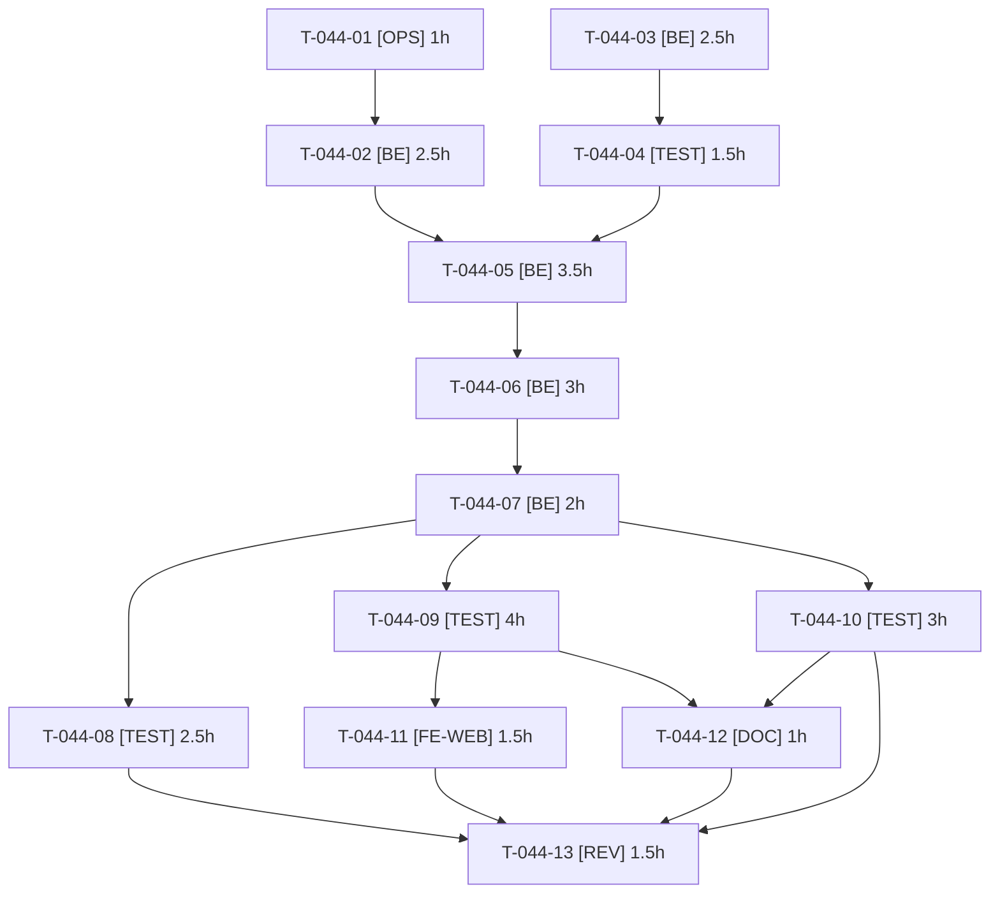

# Tâches — US-044 : Données de remplissage des contenants (container-fill)

## Informations US

- **Epic** : EPIC-02
- **Persona** : Nadia
- **Story Points** : 5
- **Sprint** : sprint-9-reports
- **Dépendances** : US-008, US-010, US-039 (livrées)

## Résumé

En tant que Nadia, je veux voir dans la démo comment une commande remplit des cartons, des palettes, un camion ou un conteneur, afin d'évaluer comment le plugin pousse mes acheteurs à commander par unités logistiques complètes.

## Faits relevés dans le code (base de la décomposition)

- Plugin `tmonier/sylius-container-fill-plugin` : la fixture `tmonier_container_fill_container_types` (`ContainerTypePresetFixture`) est idempotente (`findOneByCode`) et crée les 13 presets (indicatifs) pour toutes les locales présentes. Elle lit les locales : elle doit passer **après** la fixture `locale`.
- Unités du plugin : **millimètres et grammes** (`setInnerLength`, `setMaxPayload`, `ProductVariantLogistics::caseWeight`, en grammes). Les CSV sont en **centimètres et kilogrammes** (`weight_kg`, `width_cm`, `height_cm`, `depth_cm`) : conversion ×10 (cm→mm) et ×1000 (kg→g), arrondie à l'entier.
- Entités : `ProductVariantLogistics` (unitsPerCase, caseWeight, stackable, layerHeight, ownPallet, caseMultipleRequired), `VariantContainerCapacity` (variante, type de contenant, quantité, unitsPerLayer), `ContainerRule` (canal, portée all/taxon/product, types de contenants, mode, seuil), `ContainerType` (`layerMode`, `maxLayers`).
- Modes de règle (`ContainerRuleInterface`) : `min_fill_percent`, `full_only`, `multiple_of`, `max_containers`.
- Suite `demo` (`config/packages/demo_fixtures.yaml`) : priorités **négatives** (taxons -10, attributs -20, produits `demo_products_csv` -30, entreprises/clients -15, plugins -40/-50). `demo_container_fill` doit passer après les produits : **-40** (aucune dépendance sur -40/-50, mais après les entreprises si une règle cible un groupe de clients). Injecter `EntityManagerInterface` (pas de `ObjectManager` générique).
- Colonne `attributes_json` des CSV : `packaging_unit` (« boîte de 100 », « lot de 25 »…), source des unités par colis.

## Vue d'ensemble des tâches

| ID | Type | Tâche | Estimation | Dépend de | Statut |
|----|------|-------|------------|-----------|--------|
| T-044-01 | [OPS] | Charger la fixture des presets du plugin dans la suite `demo` (priorité négative, après canaux et locales) | 1h | — | 🔲 |
| T-044-02 | [BE] | Squelette de la fixture `demo_container_fill` : priorité -40, `EntityManagerInterface`, lecture des CSV partagée avec `demo_products_csv`, upsert par variante | 2.5h | T-044-01 | 🔲 |
| T-044-03 | [BE] | `ContainerCapacityCalculator` : conversion cm/kg → mm/g, volume utile × rendement du preset borné par la charge utile | 2.5h | — | 🔲 |
| T-044-04 | [TEST] | Tests unitaires du calculateur et validation à la main sur 3 produits | 1.5h | T-044-03 | 🔲 |
| T-044-05 | [BE] | Données logistiques par variante : poids du colis, unités par colis (depuis `packaging_unit`), vente par colis entiers pour visserie et emballage | 3.5h | T-044-02, T-044-04 | 🔲 |
| T-044-06 | [BE] | Capacités pour la palette EUR et les cartons S/M/L ; mode « couches » sur la palette EUR pour au moins une famille | 3h | T-044-05 | 🔲 |
| T-044-07 | [BE] | Règles sur le canal B2B seul : une règle bloquante (`full_only`, famille lourde) et une règle `min_fill_percent` (jauge sans tout bloquer) | 2h | T-044-06 | 🔲 |
| T-044-08 | [TEST] | Idempotence et reset : `app:demo:reset` deux fois, mêmes nombres (types, données logistiques, capacités, règles) ; durée du reset mesurée | 2.5h | T-044-07 | 🔲 |
| T-044-09 | [TEST] | Rendu réel : jauge accessible et commande bloquée pour Claire (B2B), « compléter la palette », colis de 100 refusé à 150, commande aboutie + plan dans l'admin, B2C sans jauge | 4h | T-044-07 | 🔲 |
| T-044-10 | [TEST] | Non-régression : PunchOut, devis, approbation d'achat, commande rapide, historique, `demo_orders` ; dérogation non accordée à l'admin restreint | 3h | T-044-07 | 🔲 |
| T-044-11 | [FE-WEB] | Catalogue des plugins (`config/demo/plugins.yaml`, page `/{locale}/plugins`) : parcours de démo FR/EN (compte, produits, résultat attendu) | 1.5h | T-044-09 | 🔲 |
| T-044-12 | [DOC] | Formule de capacité, conversions d'unités, jeu de règles et parcours de démo | 1h | T-044-09, T-044-10 | 🔲 |
| T-044-13 | [REV] | Revue : calculs, règles sans effet sur les scénarios, aucun secret, idempotence | 1.5h | T-044-08, T-044-10, T-044-11, T-044-12 | 🔲 |

**Total estimé : 29.5h** (13 tâches)

---

## Détail des tâches

### T-044-01 — Charger la fixture des presets du plugin dans la suite `demo`

- **Type** : [OPS]
- **Estimation** : 1h
- **Dépend de** : —

**Description** :
Ajouter `tmonier_container_fill_container_types` à la suite `demo` avec une priorité négative (-5) pour passer après `locale` et `channel` (priorité 0). Ne **pas** charger `tmonier_container_fill_demo` (3 produits anglais hors arborescence, règle sur tous les canaux, acheteur `pallet@example.com` avec le mot de passe `sylius`).

**Fichiers (indicatifs)** :
- `config/packages/demo_fixtures.yaml`

**Critères de validation** :
- [ ] Après `sylius:fixtures:load demo` : 13 presets (palettes EUR, demi, UK, US ; semi-remorques standard et méga ; US 53 ft ; conteneurs 20 ft, 40 ft, 40 ft HC ; cartons S, M, L)
- [ ] Noms présents en `fr_FR` et `en_US`
- [ ] Aucun compte `pallet@example.com`

---

### T-044-02 — Squelette de la fixture `demo_container_fill`

- **Type** : [BE]
- **Estimation** : 2.5h
- **Dépend de** : T-044-01

**Description** :
Fixture `demo_container_fill` (priorité -40, après les produits -30), `EntityManagerInterface` injecté. Réutiliser le lecteur CSV de `demo_products_csv` (une seule source des 210 produits, DRY) pour parcourir SKU, `attributes_json`, poids et dimensions. Upsert par variante (recherche avant création) pour l'idempotence. Un seul `flush()` par lot.

**Fichiers (indicatifs)** :
- `src/DataFixtures/ContainerFillFixture.php`
- `config/services/demo_fixtures.yaml` (ou équivalent existant)
- `config/packages/demo_fixtures.yaml`

**Critères de validation** :
- [ ] Fixture enregistrée avec son nom et sa priorité
- [ ] Aucune lecture CSV dupliquée
- [ ] Rechargement sans doublon

---

### T-044-03 — `ContainerCapacityCalculator` : conversion et capacité

- **Type** : [BE]
- **Estimation** : 2.5h
- **Dépend de** : —

**Description** :
Service pur (sans accès base) : `cm→mm` (×10) et `kg→g` (×1000) avec arrondi entier ; capacité = min( ⌊volume utile × rendement du preset ÷ volume unitaire⌋ , ⌊charge utile ÷ poids unitaire⌋ ), le volume utile de la palette étant longueur × largeur × hauteur de chargement max. Calcul simple et documenté (rendement 85 à 90 % du preset). Produit sans dimension ou sans poids : aucune capacité (jamais de division par zéro).

**Fichiers (indicatifs)** :
- `src/Logistics/ContainerCapacityCalculator.php`

**Critères de validation** :
- [ ] Méthodes < 20 lignes, PHPStan max
- [ ] Entrées non positives gérées

---

### T-044-04 — Tests unitaires du calculateur

- **Type** : [TEST]
- **Estimation** : 1.5h
- **Dépend de** : T-044-03

**Description** :
Cas nominal, borné par la charge utile, borné par le volume, dimension manquante ; 2 ou 3 produits réels du CSV (par exemple `VISS-001`, `EMBA-001`, un EPI) recalculés à la main et écrits dans le test.

**Fichiers (indicatifs)** :
- `tests/Unit/Logistics/ContainerCapacityCalculatorTest.php`

**Critères de validation** :
- [ ] 3 produits validés à la main
- [ ] Conversion cm/kg → mm/g vérifiée

---

### T-044-05 — Données logistiques par variante

- **Type** : [BE]
- **Estimation** : 3.5h
- **Dépend de** : T-044-02, T-044-04

**Description** :
Pour chaque variante : `ProductVariantLogistics` avec `caseWeight` (g) et `unitsPerCase` déduit de `packaging_unit` (« boîte de 100 » → 100, « lot de 25 » → 25, absent → 1). `caseMultipleRequired` = vrai pour une sélection (visserie et fixations en boîtes, emballage par lots). Vérifier la compatibilité avec les matrices et la commande rapide (quick-order 1.1+ suit les multiples).

**Fichiers (indicatifs)** :
- `src/DataFixtures/ContainerFillFixture.php`
- `src/Logistics/PackagingUnitParser.php`

**Critères de validation** :
- [ ] Une ligne de données logistiques par variante concernée
- [ ] Unités par colis lues depuis `packaging_unit`
- [ ] Saisie 150 sur un colis de 100 refusée (vérifié en T-044-09)

---

### T-044-06 — Capacités et mode « couches »

- **Type** : [BE]
- **Estimation** : 3h
- **Dépend de** : T-044-05

**Description** :
Créer les `VariantContainerCapacity` pour la palette EUR et les cartons (S, M, L) via le calculateur. Activer `layerMode` sur la palette EUR (mode « couches », `unitsPerLayer` renseigné) pour au moins une famille ; le type étant un preset, la fixture ne le modifie que si besoin et de façon idempotente.

**Fichiers (indicatifs)** :
- `src/DataFixtures/ContainerFillFixture.php`

**Critères de validation** :
- [ ] Capacités non nulles pour les familles ciblées
- [ ] Au moins une famille avec `unitsPerLayer`
- [ ] Aucune capacité en double (variante, type)

---

### T-044-07 — Règles sur le canal B2B seul

- **Type** : [BE]
- **Estimation** : 2h
- **Dépend de** : T-044-06

**Description** :
Règle bloquante (`full_only`, palettes complètes ou camion complet) sur une famille lourde (emballage) et règle `min_fill_percent` pour montrer la jauge sans tout bloquer. Canal B2B uniquement : aucune règle sur B2C. Les seuils ne doivent pas bloquer les paniers des scénarios existants (PunchOut, devis, approbation, commande rapide, historique, `demo_orders`). Dérogation `ROLE_TMONIER_CONTAINER_FILL_OVERRIDE` non accordée à l'admin restreint.

**Fichiers (indicatifs)** :
- `src/DataFixtures/ContainerFillFixture.php`

**Critères de validation** :
- [ ] Une règle bloquante et une règle de remplissage minimal
- [ ] Aucune règle de canal B2C
- [ ] Noms de règles lisibles FR/EN si l'interface les affiche

---

### T-044-08 — Idempotence et reset

- **Type** : [TEST]
- **Estimation** : 2.5h
- **Dépend de** : T-044-07

**Description** :
Test d'intégration : `app:demo:reset` deux fois, mêmes nombres de types, données logistiques, capacités et règles ; 13 presets. Mesurer la durée ajoutée au reset (lien avec T-041-06). Pas de rebuild Docker : test ciblé local, le reste en CI.

**Fichiers (indicatifs)** :
- `tests/Functional/Demo/ContainerFillFixturesTest.php`

**Critères de validation** :
- [ ] Mêmes comptes après deux resets
- [ ] Durée ajoutée relevée dans le résultat du test

---

### T-044-09 — Rendu réel : jauge, blocage, colis, B2C

- **Type** : [TEST]
- **Estimation** : 4h
- **Dépend de** : T-044-07

**Description** :
Tests sur le **rendu réel** des pages (pas seulement des comptes en base, leçon des sprints 2 et 4) : panier de Claire (`claire@acme.example`, canal B2B) avec la jauge SVG et son texte accessible, bouton de commande désactivé avec la raison, « compléter la palette » avec la quantité manquante ; panier plein : commande aboutie et plan de chargement dans l'administration ; fiche produit : 150 refusé pour un colis de 100 avec le multiple attendu, aperçu visible ; Léa (`lea@demo.example`, B2C) sans jauge ni blocage.

**Fichiers (indicatifs)** :
- `tests/Functional/Demo/ContainerFillDemoTest.php`

**Critères de validation** :
- [ ] Scénarios Gherkin d'US-044 (jauge, règle satisfaite, colis entiers, B2C) verts
- [ ] Assertions sur le HTML rendu

---

### T-044-10 — Non-régression des scénarios existants

- **Type** : [TEST]
- **Estimation** : 3h
- **Dépend de** : T-044-07

**Description** :
Rejouer après chargement des données container-fill : PunchOut, devis, approbation d'achat, commande rapide, historique de commandes ; les commandes `demo_orders` restent valides. Vérifier que le rôle de dérogation n'est pas accordé à l'admin de démo restreint.

**Fichiers (indicatifs)** :
- `tests/Functional/` (suites existantes)

**Critères de validation** :
- [ ] Suites existantes vertes sans modification de leurs attentes
- [ ] Rôle de dérogation absent de l'admin restreint

---

### T-044-11 — Parcours de démo dans le catalogue des plugins

- **Type** : [FE-WEB]
- **Estimation** : 1.5h
- **Dépend de** : T-044-09

**Description** :
Entrée `sylius-container-fill-plugin` de `config/demo/plugins.yaml` : parcours FR/EN (compte Claire, produits de la famille bloquante, résultat attendu) visible sur `/{locale}/plugins`.

**Fichiers (indicatifs)** :
- `config/demo/plugins.yaml`

**Critères de validation** :
- [ ] Texte FR et EN
- [ ] Compte, produits et résultat attendu cités

---

### T-044-12 — Documentation

- **Type** : [DOC]
- **Estimation** : 1h
- **Dépend de** : T-044-09, T-044-10

**Description** :
Formule de capacité, conversions d'unités, jeu de règles, parcours de démo, limites (presets indicatifs).

**Fichiers (indicatifs)** :
- `docs/`

**Critères de validation** :
- [ ] Formule et exemple chiffré documentés

---

### T-044-13 — Revue

- **Type** : [REV]
- **Estimation** : 1.5h
- **Dépend de** : T-044-08, T-044-10, T-044-11, T-044-12

**Description** :
Relecture indépendante : calculs, absence de règle B2C, idempotence, aucun compte ni secret ajouté, ECS et PHPStan.

**Fichiers (indicatifs)** :
- sans objet

**Critères de validation** :
- [ ] Aucun constat bloquant

---

## Graphe de dépendances

## Résumé

| Couche | Nb tâches | Heures |
|--------|-----------|--------|
| [BE] | 5 | 13.5h |
| [TEST] | 4 | 11h |
| [OPS] | 1 | 1h |
| [FE-WEB] | 1 | 1.5h |
| [DOC] | 1 | 1h |
| [REV] | 1 | 1.5h |
| **TOTAL** | **13** | **29.5h** |
